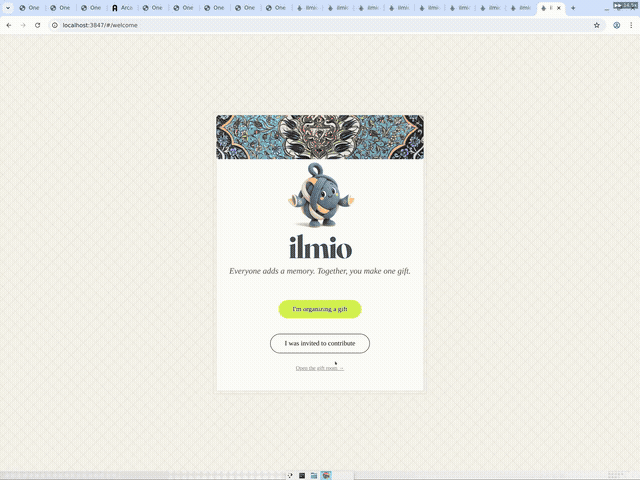

# ilmio — One Gift, Many People

**Live demo: https://accepting-compressed-minds-lit.trycloudflare.com/#/welcome**

**Everyone adds a memory. Together, you make one gift.**

## Demo video

[](https://mustafatokmak.github.io/ilmio/demo/)

[Watch with sound (plays in browser)](https://mustafatokmak.github.io/ilmio/demo/)

Built for the [Shopping 3.0 — AI Commerce Hackathon with Arcade](https://www.tech-week.com/calendar/sf/events/shopping-3-0-the-ai-commerce-hackathon-with-arcade-1aa3beea-03e6-4cae-83c1-f731dfa509d5).

## Concept

A group gift usually reflects whoever buys it. With ilmio, every friend adds a personal memory (an inside joke, a trip, a shared ritual), and AI composes those memories into one design brief. Arcade then turns that brief into real, priced products that the group ranks and approves together. When the gift arrives, the recipient gets a story card linking each detail to the friend who inspired it.

## How it works

1. **Organize**: the organizer names the recipient, occasion, and product, then names each contributor. This creates a room with a unique code (`#/room/<code>`) and an invite link (`#/join/<code>`).
2. **Contribute**: each friend opens the invite link and writes their own memory. The host can't write memories for anyone. If a friend gets stuck, "Need ideas?" asks Claude Haiku (via OpenRouter) for three personalized ideas. They can steer it with a hint and ask for "3 more ideas" as often as they like.
3. **Compose**: Haiku reads each memory and turns it into a design detail, and all the details merge into one collective brief.
4. **Generate**: Haiku writes 20 design directions. Arcade generates 20 real pillow products from them, in waves of 5 with retry on rate limits. Each product comes with its pattern, configuration, and a live quote.
5. **Rank**: each friend drag-drops the candidates into S/A/B/C/D/E/F tiers. Tiers are worth 6 to 0 points, and the scores add up across friends.
6. **Decide**: the organizer clicks "Use most-liked" or picks a specific candidate, and that one becomes the proposal. Approvals are tied to that exact version, so a new contribution resets them.
7. **Story**: once everyone approves, the recipient gets a story card and an AI-written gift narrative naming every friend.

Each step triggers the next one automatically, and the organizer can always trigger any step manually.

## What we use from Arcade

Arcade is the commerce layer. It takes the AI-composed brief and produces the pattern, a real pillow product with fabric and size configuration, and a priced quote that can be ordered. Generated results are cached in `bundles/` with provenance labels.

## Run

Requires Node 18+. No dependencies.

```bash
export ARCADE_API_KEY=...       # server-side only
export OPENROUTER_API_KEY=...   # server-side only (model: anthropic/claude-haiku-5.5)
node server.js                  # http://localhost:3847/#/welcome
node --test                     # state, ranking, and quote rule checks
```

The keys are optional. Without them, the app uses the honest local composer and replays recorded bundles, and every result shows a label saying where it came from. Keys stay on the server. They never appear in client code, bundles, or the repo.

`static/` is a client-only build of the full flow that replays recorded Arcade bundles. It has no live AI and no live generation. Deployed at https://static-gagmwyry.devinapps.com.

## Layout

- `src/state.js`: state engine (brief builder, versions, approvals, quote rules)
- `src/llm.js`: OpenRouter / Haiku (memory interpretation, brainstorm, narrative, 20 design directions)
- `src/arcade.js`, `src/provider.js`: Arcade API adapter and recorded-bundle provider
- `src/suggest.js`, `src/narrative.js`: local fallbacks
- `server.js`: dependency-free Node server, JSON API, per-room persistence (`data/state-<code>.json`)
- `public/`: the single-page app; `static/`: the static build
- `bundles/`: Arcade results keyed by brief fingerprint
- `test/`: `node:test` checks
